<p align="center">
  
</p>

<h3 align="center">Your Echo Show, rebuilt. Linux inside, Home Assistant in charge, no Amazon cloud.</h3>

<p align="center">
  <a href="https://github.com/HuskerMinion/techo5/releases/latest"></a>
  
  
  
  
  <a href="LICENSE"></a>
  <a href="https://buymeacoffee.com/huskerminion"></a>
</p>

<p align="center">
  <a href="#whats-new">What's new</a> ·
  <a href="#built-on-echolocal">Built on EchoLocal</a> ·
  <a href="#why-techo5">Why</a> ·
  <a href="#screenshots">Screenshots</a> ·
  <a href="#stock-vs-techo5">Stock vs TECHO5</a> ·
  <a href="#install">Install</a> ·
  <a href="#under-the-hood">Under the hood</a> ·
  <a href="#made-possible-by">Credits</a> ·
  <a href="https://github.com/HuskerMinion/techo5-athena">TECHO5 ATHENA</a> ·
  <a href="https://github.com/HuskerMinion/techo5-dot">TECHO5 Dot</a> ·
  <a href="https://github.com/HuskerMinion/techo5-spot">TECHO5 Spot</a>
</p>

---

> **New: the Echo Show 8 2nd gen (2021, `athena`) runs TECHO5 on a 64-bit mainline Linux kernel.**
> The story, the board and the UART pads: [TECHO5 ATHENA](https://github.com/HuskerMinion/techo5-athena).
> Install: [docs/install-athena.md](docs/install-athena.md).

**TECHO5** (Tech Echo 5) is open firmware for **Amazon's Echo Show 5 and Echo Show 8**, both
generations of each. It replaces Fire OS and Alexa with a small Alpine Linux image and one Go daemon,
turning the Show into a fast, private Home Assistant voice satellite with a touch screen of its own.
It started on the Show 5, which is where the name comes from.

**Every Echo that can be unlocked now runs it.** The bootloader exploit these devices are opened with,
[amonet](https://github.com/R0rt1z2/amonet), reaches five Amazon Echos, and saiyaku-athena unlocks a sixth. All six run the same daemon:

| Device | Model | Repository | Status |
|---|---|---|---|
|  **Echo Show 5, 2nd gen** (2021, `cronos`) | C76N8S | this one | In daily use |
|  **Echo Show 5, 1st gen** (2019, `checkers`) | H23K37 | this one, same binary; hardware notes in [techo5-checkers](https://github.com/HuskerMinion/techo5-checkers) | In daily use |
|  **Echo Show 8, 1st gen** (2019, `crown`) | C7H6N3 | this one, same binary | In daily use |
|  **Echo Show 8, 2nd gen** (2021, `athena`) | A8H3N2 | this one, same daemon on its own 64-bit mainline kernel; the story in [TECHO5 ATHENA](https://github.com/HuskerMinion/techo5-athena) | In daily use on two units |
|  **Echo Spot, 1st gen** (2017, `rook`) | VN94DQ | [TECHO5 Spot](https://github.com/HuskerMinion/techo5-spot) | In daily use |
|  **Echo Dot, 2nd gen** (2016, `biscuit`) | RS03QR | [TECHO5 Dot](https://github.com/HuskerMinion/techo5-dot) | In daily use |
|  **Echo, 2nd gen** (2017, `radar`) | XC56PY | [TECHO5 Dot](https://github.com/HuskerMinion/techo5-dot#echo-2nd-gen), same release and daemon | Working on one unit |
|  **Echo Dot, 3rd gen** (2018, `donut`) | D9N29T | [TECHO5 Dot](https://github.com/HuskerMinion/techo5-dot#echo-dot-3rd-gen), same release, its own daemon build | Working on one unit |
| **Android tablets and the Meta Portal**, no unlock | Android 8.0 or later, ARM | [TECHO5 Panel](https://github.com/HuskerMinion/techo5-panel), an app with the same daemon inside ([docs/panel.md](docs/panel.md)) | Tested on a Fire HD 8 (10th gen), a Galaxy Tab S6 Lite and a Meta Portal (2nd gen); other tablets may work |

Every other device amonet opens is a Fire tablet. No Echo made after 2021 has a public unlock.

Beyond the Echos and the Panel's tablets, the **Skylight Calendar 15** (150-CAL) runs it too, a wall
calendar with a 1920x1080 touch screen. TECHO5 puts its own 64-bit mainline kernel and the same daemon on it,
over adb, after a full backup. It has no microphone, so it's a screen and a speaker: no wake word,
voice, phone calls or intercom. Tried on one unit, the newest port:
[docs/install-skylight.md](docs/install-skylight.md).

How it compares with EchoLocal, EchoMuse, echo-dot-assist, Kiosk Satellite and View Assist:
[docs/comparison.md](docs/comparison.md).

<p align="center">
  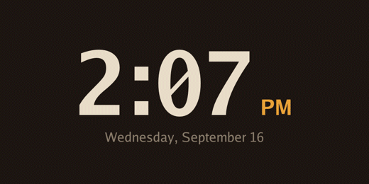
</p>

<p align="center">
  <em><strong>Waking to light.</strong> For up to half an hour before an alarm the screen becomes a
  dawn, on a curve that does most of its work near the end. Every frame here is drawn by the code
  the device draws with.</em>
</p>

## What's new

The bigger changes of September and October 2026. Every release lists the rest.

- 🌐 **Reach a device from away** (v1.6.7). An Echo Show, Echo Spot or Skylight can join your
  Tailscale network, so a device in another house stays in your own Home Assistant, and its setup page
  can be opened from afar with Remote setup. Off until you give it a key; over the tailnet only Home
  Assistant's encrypted connection, the setup page while Remote setup is on, and SSH when it's on get
  in. [docs/tailscale.md](docs/tailscale.md)
- 🆕 **The Skylight Calendar 15** (v1.3.0). Not an Echo: the 15-inch wall calendar (150-CAL) runs
  TECHO5 on its own 64-bit mainline Linux kernel. Touch, the calendar, photos, dashboards, music and
  the radio, Bluetooth, the light sensor and the clock work. It has no microphone, so there's no wake
  word or voice, and no phone calls or intercom. One command installs it over adb from its stock
  firmware, after a full backup of the unit; it has been tried on one unit. Install:
  [docs/install-skylight.md](docs/install-skylight.md)
- 📱 **TECHO5 on a tablet, no unlock** (v1.3.0). TECHO5 Panel is an Android app with the same daemon
  inside: Home Assistant adds it like an Echo, with the same wake words, screens, timers, alarms,
  intercom and announcements. No unlock and no root, on tablets and the Meta Portal. Tested on a Fire
  HD 8 (10th gen), a Galaxy Tab S6 Lite and a Meta Portal (2nd gen); other Android 8.0+ tablets may
  work. [TECHO5 Panel](https://github.com/HuskerMinion/techo5-panel), [docs/panel.md](docs/panel.md)
- 🗣️ **Also in v1.3.0.** Nearest device answers is now on by default, also on devices where it had
  been turned off. The Show 8 (both generations) draws some controls larger to fit its screen. The
  Show 8 2nd gen's kernel now picks its screen from the name the bootloader passes, so a unit
  installed with `--force-panel` gets its own screen's driver with the kernel update (ten screens
  known; only the BOE ILI9881C one tried on a unit).
- 📷 **The Echo Show 8 2nd gen's camera works** (v1.2.24). Live on its own screen, a Home Assistant
  camera, and everything else the other Shows do with theirs (presence, person detection, gestures,
  your recorder). It's off while the device is muted or the shutter is closed. It comes with a new
  kernel, which the device installs on its own as a trial and puts back if it doesn't come up right.
  Also: a **Bluetooth Secure Connections** switch for phones that pair and then drop a second later
  ([#183](https://github.com/HuskerMinion/techo5/issues/183)); on the Dot, AirPlay recovers when it
  stops showing up after the first use
  ([techo5-dot#14](https://github.com/HuskerMinion/techo5-dot/issues/14)); and the camera's
  `/camera.jpg` and `/camera.mjpeg` pages now ask for the camera password and light the green dot
  while they're watched. **If something reads those pages with no password today** (a Home Assistant
  Generic Camera, a recorder), set a camera password and give it to that with Digest authentication,
  or it stops getting pictures. [docs/setup.md](docs/setup.md#4-cameras)
- 📅 **A calendar for the wall** (v1.2.23). The calendar's new look: a day and a week on their hours,
  a cleaner month, Coming up with each day's weather, event icons, countdowns, a filter for which
  calendars a screen shows, and the next event at the foot of the clock, each with its own switch
  under Settings > Display > Calendar. The screen can stay on when you say "lights off" in its room
  ([#179](https://github.com/HuskerMinion/techo5/issues/179)), light themes work over a photo, and
  the Show's music buttons are drawn like the rest of its buttons
  ([#173](https://github.com/HuskerMinion/techo5/issues/173)). Music Assistant finds a device it
  reaches by address again after the device restarts
  ([#182](https://github.com/HuskerMinion/techo5/issues/182)), a radio favorite Home Assistant didn't
  start says why on the screen ([#174](https://github.com/HuskerMinion/techo5/issues/174)), a
  slideshow folder set again is read again at once
  ([#180](https://github.com/HuskerMinion/techo5/issues/180)), and the log says why the ambient noise
  sensor has no reading ([#178](https://github.com/HuskerMinion/techo5/issues/178)). Thanks to
  [@christianschmidt](https://github.com/christianschmidt) and [@tibole](https://github.com/tibole).
  [docs/setup.md](docs/setup.md#calendar)
- 🔗 **Settings that follow you, a realtime voice, and a camera that knows a person** (v1.2.22).
  Pick a setting on the setup page and tick the other devices that should keep it in step: each one
  agrees first, and a device that was off catches up when it's back. A wake word can be answered by a
  speech-to-speech model at OpenAI, xAI or Gemini (it sends your voice to them, and they bill for it;
  off until you choose it, with a daily limit). With presence detection on, a Show or Spot can tell a
  person from anything else that moves, on the device.
- 🎥 **Your Echo as a camera for your recorder, and cameras by the grid** (v1.2.21). A Show or Spot can
  serve its own camera to Frigate or any NVR over RTSP and ONVIF, with a login and a green dot on the
  screen while it's watched; the Show shows up to six cameras at once, and go2rtc's streams join the
  list. Off until you turn them on.
- 🗣️ **The nearest Echo answers, and more you can run from home** (v1.2.21). With several devices in
  earshot, only the one that heard you best answers. Thermostats open their controls in Drawn mode
  ([#170](https://github.com/HuskerMinion/techo5/issues/170)); settings save to a file and restore;
  a signed remote API and live logs; timers pause and take extra time from Home Assistant; and an
  event on two calendars shows once. Thanks to [@remylpat](https://github.com/remylpat), and to
  [@wonderslug](https://github.com/wonderslug) for the Echo 2nd gen's own speaker tuning
  ([#169](https://github.com/HuskerMinion/techo5/pull/169)).
- 🔊 **The Echo 2nd gen** (dot-v1.0.19). The 2017 Echo (`radar`) runs TECHO5 Dot: the same release,
  installer and daemon as the Dot, with its own amplifier, the speaker filters from the unit itself and
  its own Bluetooth kernel. Its USB is only inside the case:
  [install steps](https://github.com/HuskerMinion/techo5-dot#echo-2nd-gen).
- 🌄 **Light only alarms, and a night that's easier to live with** (v1.2.20). An alarm can be a
  wake-up light with no sound ([#164](https://github.com/HuskerMinion/techo5/issues/164)), a tap can
  lift the night light on the Show ([#163](https://github.com/HuskerMinion/techo5/issues/163)), and the
  Spot's night clock comes sooner and goes dimmer
  ([techo5-spot#7](https://github.com/HuskerMinion/techo5-spot/issues/7)). Thanks to
  [@kevin909867](https://github.com/kevin909867) and [@paolofaz](https://github.com/paolofaz).
- ⚡ **The Show 8 2nd gen at full speed** (v1.2.19). Its kernel now scales the CPUs up to 1.99 GHz
  instead of leaving them at the bootloader's 1.1 to 1.2 GHz: about 55% faster on one core and 60% on
  all eight, ahead of a Raspberry Pi 5 on all cores, with temperature control. The kernel comes over
  the air from Home Assistant like any update. Numbers:
  [TECHO5 ATHENA](https://github.com/HuskerMinion/techo5-athena#speed)
- 🌅 **A wake-up light that stays on, and sounds and wake words of your own** (v1.2.19). The light
  holds at full between close alarms and through a snooze ([#161](https://github.com/HuskerMinion/techo5/issues/161)),
  and the setup page takes your own sounds and wake word models ([#160](https://github.com/HuskerMinion/techo5/issues/160)).
  Thanks to [@7rozen7ear](https://github.com/7rozen7ear).
- 🆕 **The Echo Show 8 2nd gen** (v1.2.16). TECHO5 now runs on the 2021 Show 8 (`athena`), on its own
  64-bit mainline Linux kernel: the first OS other than Fire OS on it. Screen, touch, all four mics,
  the speaker, Bluetooth, Wi-Fi and the light sensor work. The story and the board:
  [TECHO5 ATHENA](https://github.com/HuskerMinion/techo5-athena). Install:
  [docs/install-athena.md](docs/install-athena.md)
- 🌙 **The night clock on the Spot** (spot-v1.1.14). The Spot can show the Show's dim red night clock
  at night, or turn its screen off, instead of only dimming.
- 🔊 **Speaker gain** (v1.2.15, Show 5 units with the TAS5805M amp; also the Show 8 2nd gen and the
  Dot). Up to +6 dB more, kept across restarts. Thanks to
  [@OneWithNoFace](https://github.com/OneWithNoFace).
- 📱 **Your phone plays to the device** (v1.2.11 to v1.2.15). Pair a phone and play to the Show, Spot
  or Dot over Bluetooth; pause and play on either side reach the other. Thanks to
  [@tibole](https://github.com/tibole).
- ✋ **Cancel request** (v1.2.14). A button in Home Assistant ends a request that's running, at any
  step. Thanks to [@tibole](https://github.com/tibole).

<table>
<tr>
<td width="50%"><a href="docs/screenshots/show8/dashboard-drawn.png">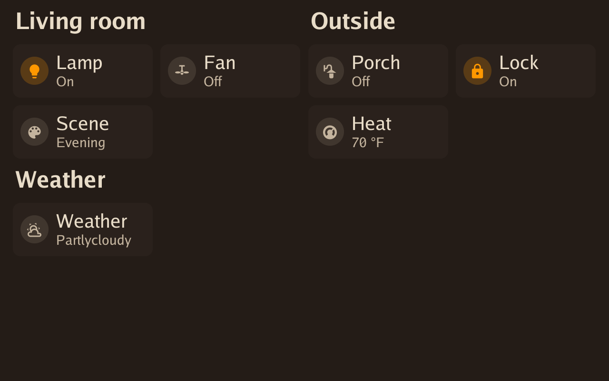</a></td>
<td width="50%"><a href="docs/screenshots/show8/dashboard-streamed.png">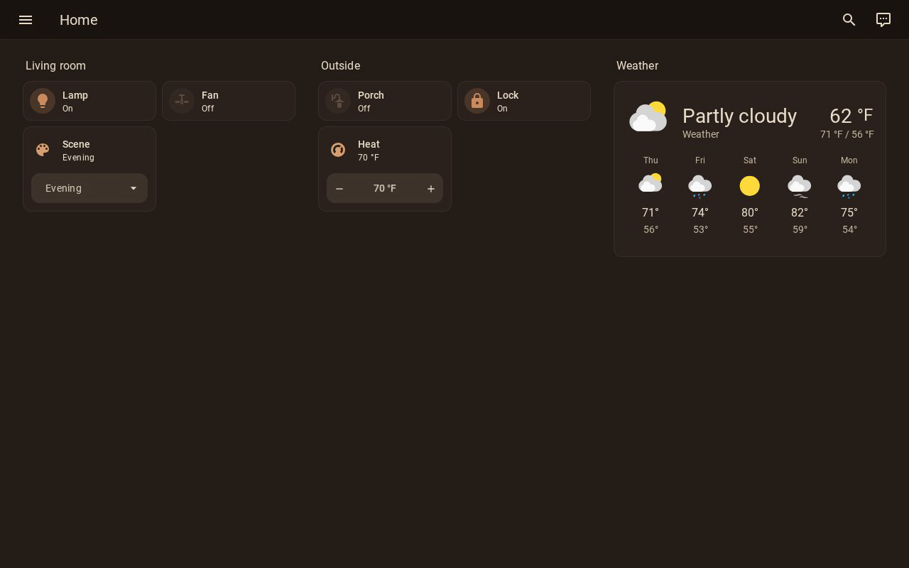</a></td>
</tr>
<tr>
<td><strong>Drawn on the device</strong>: instant, no server</td>
<td><strong>Streamed</strong>: exactly as Home Assistant draws it</td>
</tr>
</table>

**Home Assistant dashboards on the screen** (v0.9.0). The Echo Show and the Echo Spot can show a
dashboard as a page you swipe in from the left edge of the clock (on the Spot, from the ring menu),
or in place of the clock when nothing else is on the screen. There are two ways, picked per device in
Home Assistant:

- **Drawn on the device.** The device reads the dashboard's cards and draws them itself, in your
  theme's colors: tiles you can tap or slide for brightness, position and temperature, rows with
  switches, graphs, gauges, pictures and more. Taps are instant and nothing else is needed. With no
  dashboard picked, it builds a Rooms dashboard from your Home Assistant areas.
- **Streamed.** [dashcast](dashcast/README.md), a small server that runs next to Home Assistant
  (a Docker image for PCs and Raspberry Pis), opens the dashboard in a headless browser and sends the
  screen only what changes, encrypted with a key of your choosing. It looks exactly as Home Assistant
  draws it, custom cards included, and it can show built-in pages like Energy and History.

For a Show on a wall, a tap on the clock can open the dashboard, a few tiles can fill the whole
screen, and the clock comes back on its own after the time you choose.

Which to use, how to set it up and what each can do: **[docs/dashboards.md](docs/dashboards.md)**.

<table>
<tr>
<td width="50%"><a href="docs/screenshots/now-playing-cover.png">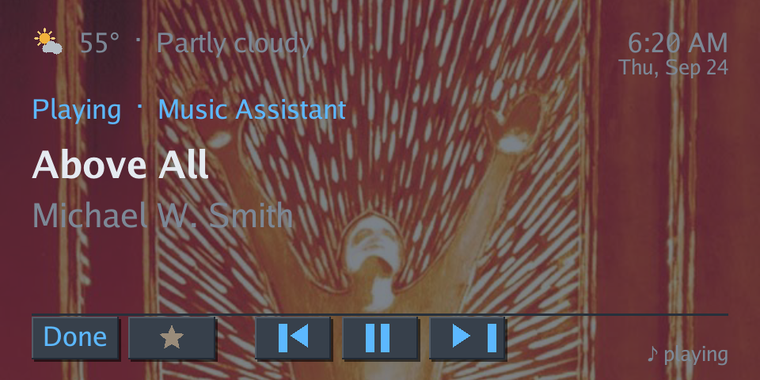</a></td>
<td width="50%"><a href="docs/screenshots/spot/now-playing-cover.png">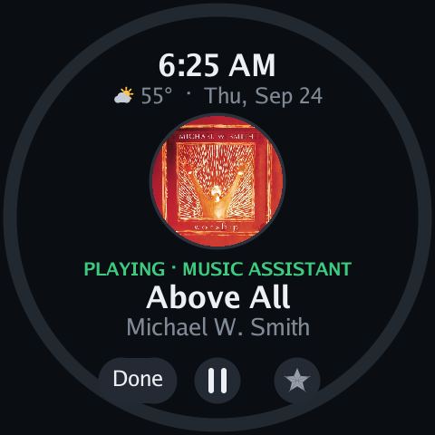</a></td>
</tr>
<tr>
<td colspan="2"><strong>Cover art for Music Assistant</strong> (v0.8.13). Music from Music Assistant, your own library included, now shows its album cover on the now-playing screen, the way radio stations already did. Music Assistant sends the picture itself, so there's nothing to set up. On the Spot it sits in a circle over the song.</td>
</tr>
</table>

- 💬 **Notifications from Home Assistant** (v1.2.7). An automation can put a notification on the
  screen: a title and a few lines, or its words over a picture, such as a doorbell's camera. It can
  chime and be read aloud, and Home Assistant gets an event when it is tapped or its time runs out. A
  Dot chimes and speaks. Thanks to [@wonderslug](https://github.com/wonderslug).
  [docs/actions.md](docs/actions.md#show-a-notification)
- 🎶 **What's playing, in Home Assistant** (v1.2.7). New sensors say what the device plays: the
  source, title, artist, album and whether it is playing or paused, for AirPlay, Spotify, DLNA, Music
  Assistant, a phone over Bluetooth and the radio. Thanks to [@maxvaega](https://github.com/maxvaega).
  [docs/setup.md](docs/setup.md#5-music)
- 🎚️ **Spotify's slider follows the device** (v1.2.7, not tested on a device yet). The Spotify app's
  volume slider and the device's volume are one: the slider sets the device, and the buttons, Home
  Assistant and night volume move the slider. If you use Spotify Connect, open an issue to say whether
  it works for you. [docs/setup.md](docs/setup.md#5-music)
- 🔤 **Fonts, and fonts of your own** (v1.2.7). The Show and the Spot can draw their words in one of
  nine other fonts instead of Go. A font file of your own fills in what those fonts lack, such as
  Korean, Chinese or Japanese song titles. [docs/setup.md](docs/setup.md#fonts-of-your-own)
- 📍 **A fixed network address** (v1.2.7, Show and Spot). Set on the screen, the setup page or from
  Home Assistant. A new address is tried before it is kept. Thanks to
  [@mawi13](https://github.com/mawi13). [docs/setup.md](docs/setup.md#9-a-fixed-address)
- 🎥 **Live camera video** (v1.2.7, off by default). With **Live camera video** on, a camera Home
  Assistant can stream shows as live video, with its sound, decoded on the device instead of
  snapshots. On the Show a camera's own RTSP address can be used for its picture and sound too, for
  less delay. Thanks to [@mawi13](https://github.com/mawi13).
  [docs/setup.md](docs/setup.md#4-cameras)
- 🌧️ **Rain sounds by voice** (v1.2.7). A ready-made automation plays a free online rain stream on
  the device that heard "play the sounds of rain".
  [docs/actions.md](docs/actions.md#play-rain-sounds-by-voice)
- 🔔 **A doorbell chime for Reolink doorbells** (v1.2.5). With the doorbell on a Reolink Home Hub or
  NVR, a press rings a classic three-tone door chime and puts its camera up on a Show or Spot, with no
  Home Assistant needed. [docs/setup.md](docs/setup.md#a-doorbell)
- 🔊 **Fuller sound** (v1.0.0). Music no longer sounds flat or dips when the bass hits: the volume
  now goes in front of the speaker's own tuning, as on Amazon's software, so the limiter only works
  near the top of the dial. Every volume step is as loud as it was. On every Echo.
- 🖼️ **A Show on the wall** (v1.0.0). A tap on the clock can open the dashboard instead of Assist, a
  few dashboard tiles can fill the whole screen, and a dashboard you opened goes back to the clock
  after the time you choose. All of it can be set from the setup page.
  [docs/dashboards.md](docs/dashboards.md)
- 🌍 **The clock in your language** (v1.0.0). With Screen language set to German, Spanish, French,
  Italian, Dutch, Portuguese or Russian, the clock's date, the forecast and the weather are
  written in it.
  [docs/setup.md](docs/setup.md#clock-and-home-screen)
- 🎶 **Now playing follows another speaker, and lyrics** (v1.0.0). Now playing can follow another of
  Home Assistant's players, a Sonos in the same room say: its song and cover show while the device
  plays nothing of its own, and the buttons control it. A Lyrics switch (off by default) shows the
  words in time with the music, from the free LRCLIB database, for Music Assistant, DLNA and followed
  players. [docs/setup.md](docs/setup.md#5-music)
- 👀 **Presence detection** (v1.0.0). The Show's and the Spot's camera can notice somebody near: a
  Motion sensor for Home Assistant, and the screen goes out when the room has been empty a while and
  comes back as you walk up. On the device only, nothing kept; off by default.
  [docs/setup.md](docs/setup.md#presence-and-gestures)
- ✋ **Cover the camera to stop an alarm** (v1.0.0). With Gestures on, a palm over the
  camera stops a ringing alarm or timer and sends Home Assistant an event. Off by default.
  [docs/setup.md](docs/setup.md#presence-and-gestures)
- 🔒 **A settings lock** (v1.0.0). Set a PIN and the Show and the Spot ask for it before their
  settings change; alarms, the volume, the brightness and everything else in daily use keep working
  for guests and kids. Off by default.
  [docs/setup.md](docs/setup.md#8-settings-lock)
- 📡 **DLNA, and FLAC** (v1.0.0). Every device can be a DLNA speaker that music apps and servers play
  to (BubbleUPnP, Jellyfin, Plex, a NAS), off until you turn it on. Streams in FLAC now play on the
  device too, alongside MP3 and WAV. [docs/setup.md](docs/setup.md#5-music)
- 📲 **AirPlay and Spotify Connect** (v0.9.25). The Show and the Dot can be a speaker other apps
  play to, under the device's own name: AirPlay from an iPhone, iPad or Mac, and Spotify Connect
  from the Spotify app (Premium). Both are off until you turn them on, on the screen, the setup page
  or in Home Assistant, and what they play shows as now playing. Since v1.2.7 the Spotify app's
  slider follows the device's volume, and the device follows the slider. If something does not work,
  open an issue.
  [docs/setup.md](docs/setup.md#5-music)
- 🛡️ **A firewall on Wi-Fi** (v0.9.25). The Show and the Spot now take nothing in over Wi-Fi but what
  they serve, as the Dot already did.
- ⚙️ **Settings that are easier to find** (v0.9.25). The long settings cards are grouped under
  headings, with what is changed most at the top, and the setup page opens Sound & Voice with the
  volume, wake word, quiet hours and do not disturb. The Spot's screen and the setup page also offer
  the Audio output choice, for a device with a headphone jack.
- 🚪 **Talk through cameras** (v0.9.24): answer the door from another room, straight to a camera's
  own speaker. [docs/setup.md](docs/setup.md#talking-through-a-camera)
- 🗣️ **It stops listening when you stop talking** (v0.8.14). After the wake word, the device hears
  you finish and ends the turn itself, instead of waiting for Home Assistant. With a TV or other
  voices in the room, that used to mean 10 to 15 seconds of listening, or a turn that timed out and
  did nothing. A switch per device, *End of speech on the device*, puts it back the old way.
- 🌙 **A night light** (v0.8.12, v0.8.13). Night hours can dim the screen to a faint glow instead of
  turning it off, and the first touch only brings it up. Music playing at night no longer keeps it
  bright, and *Night light brightness* (1 to 10) in Home Assistant sets the glow.
  [Screenshot](docs/screenshots/night-light.png)
- 🎵 **Music that behaves** (v0.8.9 to v0.8.13). A mini player strip over the clock with its own
  controls, Done and a favorite star on the now-playing page, pause and play that keep your place
  with Music Assistant, and answers and announcements that play over the music, ducked, instead of
  stopping it. Two ways a device could end up saying "Playing" in silence are fixed.
  [Screenshot](docs/screenshots/now-playing-strip.png)
- ⏰ **Alarms and reminders** (v0.8.1 onward). An alarm or reminder can ring once on a particular
  day, each alarm can choose its own wake light, and reminders can be set by voice ("remind me
  every Wednesday at 8 to take the trash out") with the automation in
  [docs/actions.md](docs/actions.md#stop-a-ring-and-set-reminders-by-voice).
  [Screenshot](docs/screenshots/alarm-editor.png)
- 🔁 **A Restart button** in Home Assistant for every device (v0.8.13): restarts the TECHO5 software
  the way an update does, for when something is stuck and you'd rather not unplug it.
- 🌧️ **Sleep sounds** (v0.8.14). "Play the sounds of rain" no longer brings up the forecast, and a
  sound file served by Home Assistant shows its own name on the now-playing page. The sound comes
  from Home Assistant: a ready-made automation is in
  [docs/actions.md](docs/actions.md#play-rain-sounds-by-voice).
- 🎙️ **More by voice**, with ready-made Home Assistant automations in
  [docs/actions.md](docs/actions.md#set-cancel-and-list-alarms-and-change-the-volume-by-voice):
  set, cancel and list alarms ("cancel the 6 AM alarm", "what alarms do I have"), and change the
  volume on the speaker you're talking to rather than every speaker in the room.
- 📺 **The Echo Show 8** (v0.8.0) runs the same software, laid out for its bigger screen.
  [Screenshots](docs/screenshots/README.md#echo-show-8)

## Built on EchoLocal

TECHO5 started from **[EchoLocal](https://github.com/ygelfand/echolocal)** by Yuri Gelfand (MIT),
which already turns the Echo Dot 2 (`biscuit`, the same MT8163 family) into an ESPHome-native Home
Assistant satellite, with a single static Go daemon that drives the hardware directly. TECHO5's
`echod` is that daemon, vendored and ported to the Show 5's `cronos`, and much of it is still
EchoLocal's code: the wake word engine, the ALSA client and the service framework almost unchanged,
and the voice satellite, media player and component registry grown from EchoLocal's own. What TECHO5
added is the Show's hardware, the screen, the camera, Bluetooth, the update and
slot system, phone calls, and a minimal Alpine root filesystem in place of Android. See
[NOTICE](NOTICE) for the full attribution and EchoLocal's license.

## Why TECHO5

|  |  |
|---|---|
| 🐧 **Real Linux, no Android** | The Show boots straight into a minimal Alpine Linux root filesystem. No Android framework, no Google services, no app store: one daemon drives the microphones, speaker, screen, camera and radios directly. |
| 🚫 **No Alexa, no Amazon account, no Amazon cloud** | Your voice goes only to *your* Home Assistant, over its encrypted ESPHome API. The Show reaches the internet just for what you use: update checks against this repo, network time, radio streams with their song and cover lookups, the rain radar map, and in the U.S. the National Weather Service's weather alerts. Voice and control keep working with the internet down, as long as your Home Assistant pipeline is local. |
| 🎙️ **Two wake words, two assistants** | microWakeWord runs on the device and listens for two wake words at once, each with its own Home Assistant assistant: "Okay Nabu" for a local one and "Hey Jarvis" for a cloud one, say. Each has its own sensitivity, sounds, ring and follow-up. Twelve words come with it ("Alexa", "Okay Nabu", "Hey Jarvis", "Hey Mycroft", "Computer" and more), and you can add your own. Say "stop", with no wake word, to stop an alarm, an answer or the music. Echo cancellation keeps it listening over music. [docs/setup.md](docs/setup.md#two-wake-words-two-assistants) |
| 🧠 **Voice without Home Assistant, if you want** | Instead of Assist, the device can use your own speech servers (Wyoming: faster-whisper and Piper) and a chat model (llama.cpp, Ollama or anything OpenAI-style). It sets timers and alarms, plays the radio and Music Assistant, changes the volume and calls other devices, and can look things up with SearXNG. Or answer a wake word with a realtime voice at OpenAI, xAI or Gemini, with your own key. [docs/setup.md](docs/setup.md#voice-without-home-assistant) |
| 🔐 **Secure by default** | SSH is keys-only and off until you turn it on; keys arrive only through Home Assistant. The camera and screen web pages start closed, and a firewall lets in nothing on Wi-Fi but what the device serves. No password logins, not even in rescue. |
| 🔄 **Updates that can't brick it** | Signed releases install over the air from Home Assistant's update card into the spare of two root filesystem slots, boot on trial, and fall back on their own if the new one doesn't settle. Follow the stable or the dev channel, and let it install on its own between 2 and 5 AM if you like. |
| 📺 **A screen that's actually useful** | Clock and weather, the conversation as it happens, a glance strip of chips from Home Assistant along the foot of the clock, a calendar, now playing with song, cover art and lyrics, your Home Assistant dashboards, forecasts, a live rain radar, the National Weather Service's alerts (in the U.S.), live cameras from Home Assistant or go2rtc, up to six at once, notifications, timers and alarms, Wi-Fi setup, 13 themes, ten fonts, eight languages, and 15 clock styles you swipe between. Auto-brightness follows the room's light. |
| 📅 **A calendar on the screen** | Home Assistant's calendars, or any calendar's own iCal link: a day and a week on their hours, the month, Coming up with the weather, event icons and countdowns, pop-ups for the calendars you choose, and the next event under the clock. [docs/setup.md](docs/setup.md#calendar) |
| 🖼️ **Your photos, three ways** | From anything Home Assistant's media library can browse (its media folder, network shares, Immich), from Immich directly (an album, favorites, dates, a person), or kept on the device from the setup page. Behind the clock or as a screensaver, whole photos with blurred sides, two tall ones side by side, with date and place. [docs/setup.md](docs/setup.md#2-photos) |
| 🏠 **The whole house, even with Home Assistant down** | Announce to every device, in typed words or your own voice. Call one device from another, with an optional Drop In. Only the nearest device answers a wake word, on by default once the devices share a house word. Settings stay in step between the devices you pick. All of it goes device to device, signed with a house word you set. [docs/phone.md](docs/phone.md#calling-another-device-in-the-house), [docs/actions.md](docs/actions.md#announce-to-the-house) |
| 🎛️ **A stream deck** | TECHO5 Deck turns a Show into pages of buttons for OBS (scenes, stream, record, mute, sources) and for your computer (shortcuts, typing, apps, websites, scripts), through a small agent for Windows, macOS and Linux. It talks to them directly, so it works without Home Assistant. [docs/deck.md](docs/deck.md) |
| 🌧️ **Sleep sounds made on the device** | Rain, ocean, wind, a brook, a fire, crickets, a fan, a cabin, and white, pink and brown noise, two at once, made as they play so they never loop. The sleep timer stops them, or any music. Bass and treble are yours to set. [docs/setup.md](docs/setup.md#5-music) |
| 🎬 **Videos on the screen** | An address from Home Assistant's `play_video` action, or a video from a DLNA app or media server (BubbleUPnP, Jellyfin, Plex, Windows' Cast to device), plays full screen with its sound, on the Show and the Spot. H.264 at 720p plays best. Off until you turn it on, and a DLNA video from a new address asks on the screen first. [docs/video.md](docs/video.md) |
| 📻 **Weather and radio with no setup** | A new Show uses the forecast every Home Assistant has, and lists the radio stations near home from Home Assistant's Radio Browser. Pick another weather entity (your own station, say) on the screen, and keep your own favorite stations too. |
| ⏰ **Alarms that ring on their own** | Set on the screen, by Home Assistant, or followed from its helpers; they ring from the Show's own clock even when Home Assistant is down. Snooze included, and the screen can wake you with a sunrise before the sound. |
| 🎧 **Bluetooth, rebuilt** | Earbuds and speakers over A2DP, plus a Home Assistant Bluetooth proxy, on a kernel rebuilt with Bluetooth from the LineageOS source. |
| 📞 **A speakerphone again** | Calls through your own SIP provider: "call Alex" by voice, calls that ring on the screen, calls between your own devices, and a help call that alerts your phones and dials people in turn. Encrypted end to end to the provider, and off until you sign it in. [docs/phone.md](docs/phone.md) |
| 📷 **A camera you control** | The front camera becomes a Home Assistant camera entity, off unless something is watching, and physically off while the mute button is engaged. |
| 🛟 **Always recoverable** | A rescue environment with a USB serial console, and TWRP left in place: LineageOS is one flash away. |

## Screenshots

Straight from the device's own screen. **[All of them](docs/screenshots/README.md)**, including the
Echo Show 8 and the Echo Spot, are in [docs/screenshots](docs/screenshots/README.md).

| | |
|---|---|
| 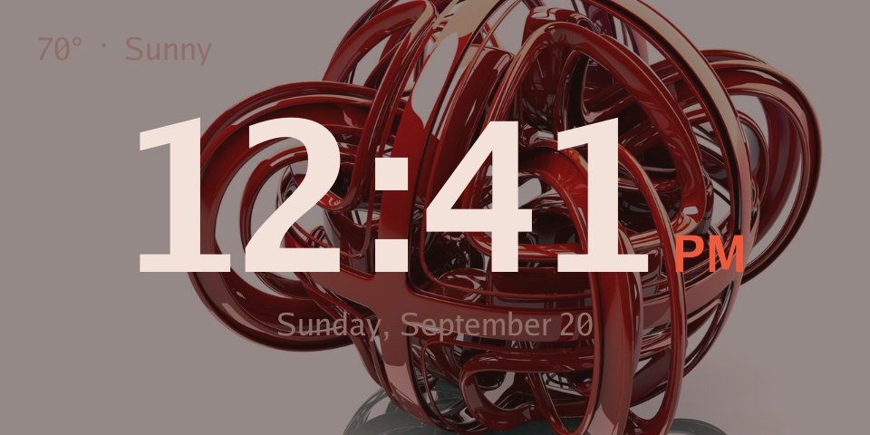 | 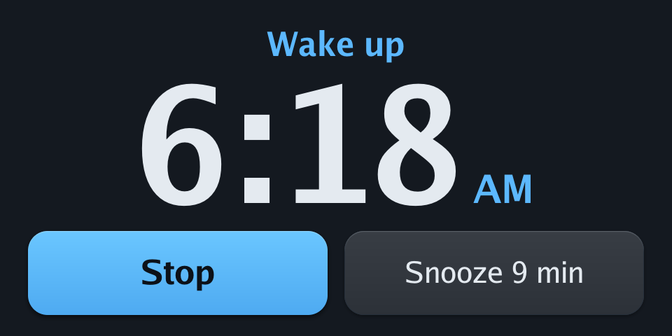 |
| **Clock**, weather and your own photos behind it | **Alarm ringing**, big enough to hit half awake |
|  | 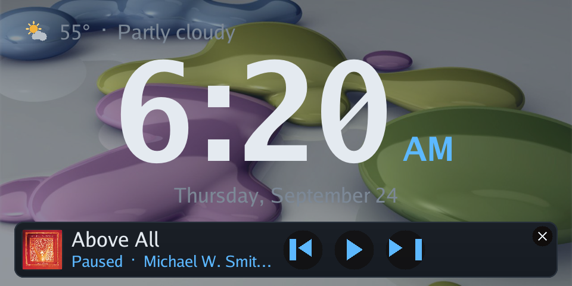 |
| **Now playing**, with the album's cover | **The mini player**, over the clock |
| 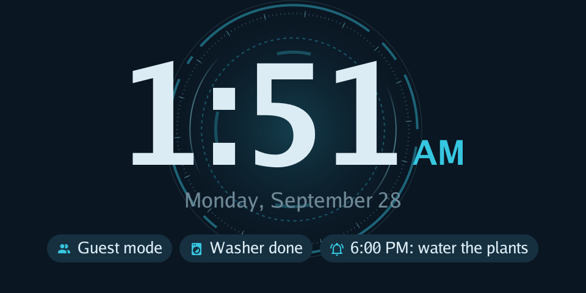 | |
| **The glance strip**: chips from Home Assistant, only while they have news | |
| 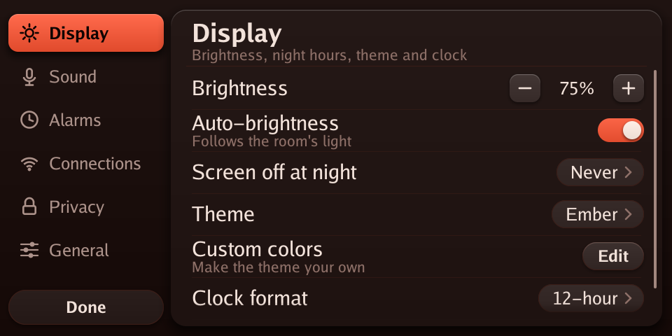 | 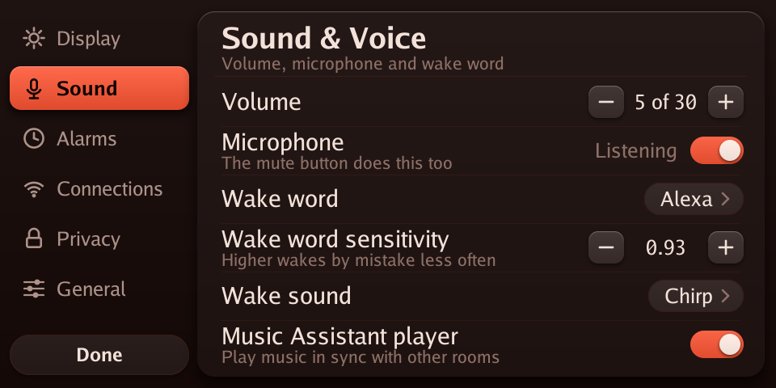 |
| **Settings** by category, grouped under headings: brightness, night, look, home screen, weather | **Sound & Voice**: the speaker, then voice, quiet, music and cameras |
| 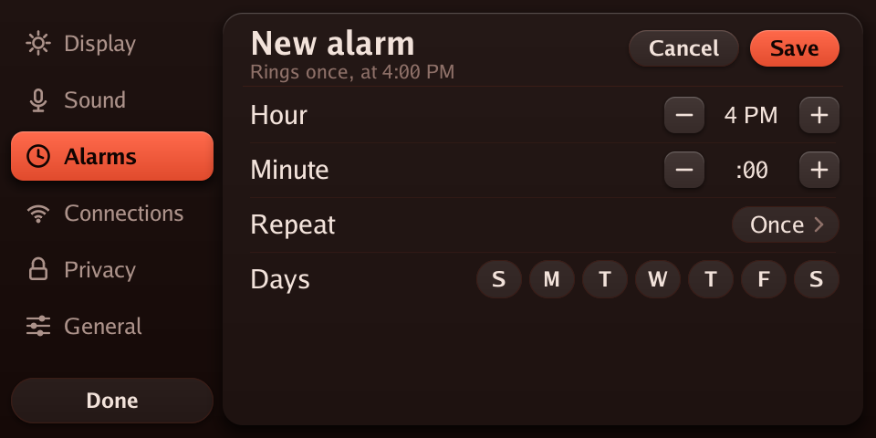 | 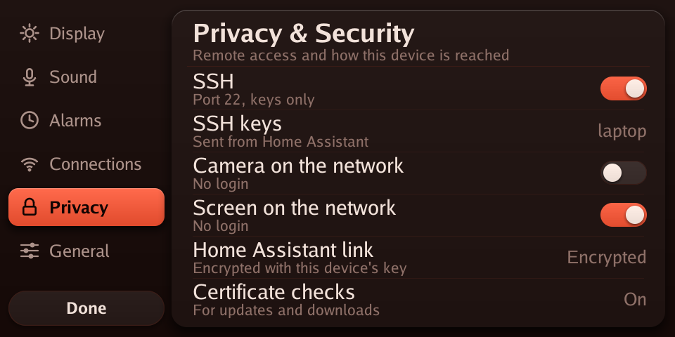 |
| **Alarms** set on the device, no app needed | **Privacy**: every open door has a switch |
| 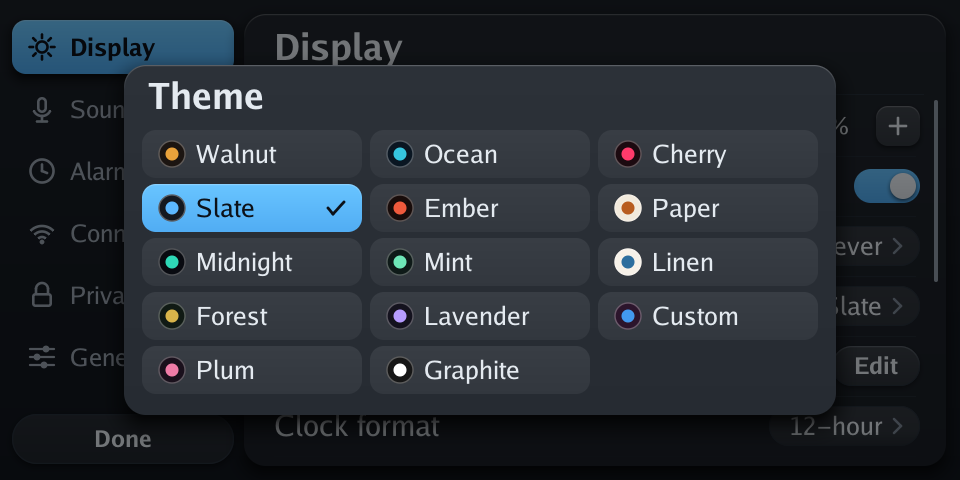 | 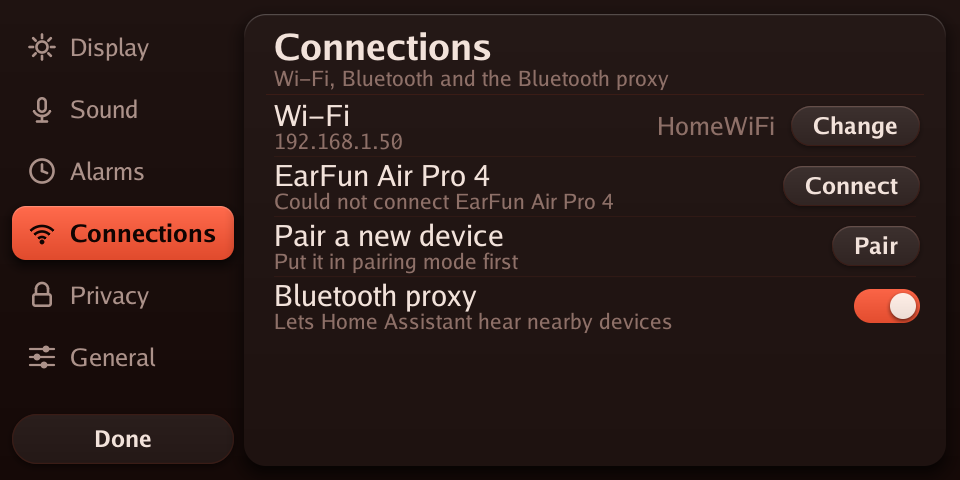 |
| **Themes**: presets or your own colors | **Connections**: Wi-Fi, Bluetooth and the Home Assistant proxy |
| 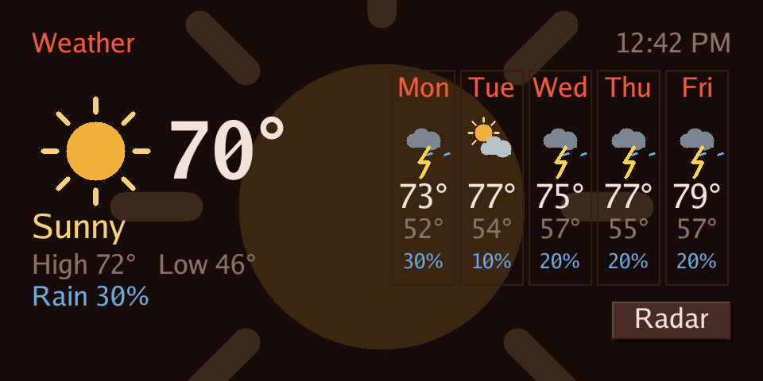 | 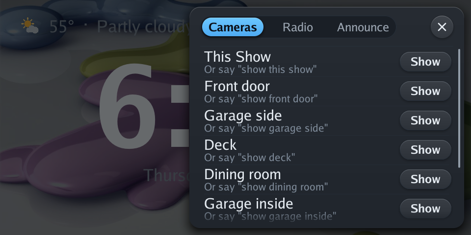 |
| **Weather** now and for the week, with the rain radar a tap away | **Cameras and Radio**, a swipe in from the right |

<p align="center">
  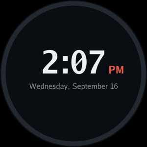
</p>

<p align="center">
  <em>The <strong>Echo Spot</strong> takes the same twenty minutes across its round face.</em>
</p>

## Stock vs TECHO5

| | Stock Echo Show (Alexa) | TECHO5 |
|---|---|---|
| Operating system | Fire OS (Android) | Alpine Linux, one daemon |
| Voice assistant | Alexa, in Amazon's cloud | Home Assistant Assist, with any pipeline you run, a different one for each wake word; or your own speech servers and chat model, with no Home Assistant |
| Where your voice goes | Amazon | Your Home Assistant, encrypted |
| Wake word | "Alexa", processed for Amazon | On the device, two at once: Alexa, Okay Nabu, Hey Jarvis, Hey Mycroft, eight more, or your own. Plus a "stop" word |
| Screen | Alexa cards and ads | Clock, weather, now playing, Home Assistant dashboards, cameras, timers, alarms, settings |
| Music | Amazon Music and skills | Home Assistant radio lists with cover art, Music Assistant (Sendspin), Home Assistant media, AirPlay and Spotify Connect (Show and Dot), DLNA, a phone over Bluetooth, sleep sounds made on the device |
| Timers and alarms | Alexa | Home Assistant timers on screen; alarms that ring without Home Assistant |
| Camera | Video calls, Drop In | A Home Assistant camera entity, off unless watched; a camera for Frigate or an NVR over RTSP and ONVIF, if you turn it on; presence and gestures, on the device only |
| Bluetooth | Speaker and phone audio | Audio to earbuds and speakers; Home Assistant Bluetooth proxy |
| Smart home | Alexa routines | Everything Home Assistant does |
| Updates | Amazon, automatic, whenever | From this repo's releases, when you press Install, or overnight if you choose; A/B slots with automatic fallback |
| Remote access | None | SSH with keys, off by default |
| Listening on your network | Amazon's services | Home Assistant's encrypted API and the Sendspin player; SSH, web pages, AirPlay and Spotify Connect only when switched on, behind a Wi-Fi firewall. A signed-in phone keeps its own connection out to the provider |
| Calling | Alexa calling and Drop In | Phone calls through your own SIP provider (TLS and SRTP), placed from Home Assistant or by voice, answered on the screen; device to device calls and announcements in the house, even with Home Assistant down, and Drop In if you turn it on |
| Shopping, skills | Yes | **No.** Those are Alexa cloud services |

## How well does it hear?

| Device | Mics |
|---|:---:|
| Echo Show 5, 1st and 2nd gen | 2 |
| Echo Show 8, 1st and 2nd gen | 4 |
| Echo Spot | 4 |
| Echo Dot, 2nd gen | 7 |
| Echo, 2nd gen | 7 |

The Dot's seven are a ring of six plus one in the middle, the best array of the bunch.

The wake word runs on the device itself. After that, what you say goes to your Home Assistant
pipeline, so misheard words are mostly down to the speech to text you have set up in HA, not the
mics. There's echo cancellation too, so it can hear you over its own music.

You can tune a lot of it from Home Assistant: **Microphone gain**, **Microphone mixing** (all
averaged, center mic only, delay and sum, or beamformer), **Microphone noise reduction**,
**Microphone echo cancellation** and the **Wake word threshold**. The defaults are what worked best
in my testing, but every room is different.

If the device's own models don't hear your voice well, Home Assistant's wake word engine
(openWakeWord, say) can listen alongside it, or only check the wakes the device wasn't sure of:
[Wake word on Home Assistant](docs/setup.md#wake-word-on-home-assistant). **Keep wake clips** saves
what your room really says, so a model you train fits it:
[Wake word clips](docs/setup.md#wake-word-clips).

On my Show 5 it hears me fine from across the room without raising my voice. With music playing I
have to raise my voice, and sometimes still need to tap the screen or a button to get it to hear me.

Amazon's own voice processing chip isn't used, so it's not going to match Alexa at its best. It's a
lot better than it was a month ago though, and still getting better.

## Install

**New to this? Start with [Getting started](docs/getting-started.md)**: every step from a stock Echo
Show 5, Dot or Spot, with the unlock guides linked, what to check after each step, and notes for
Windows, Linux and macOS. Once it's in Home Assistant, **[Setting it up](docs/setup.md)** covers
photos, weather, cameras, music and the night settings, in order.

You need a Show 5 **unlocked and running LineageOS 18.1** — 2nd gen with
[amonet-cronos](https://xdaforums.com/t/unlock-root-twrp-unbrick-amazon-echo-show-5-2nd-gen-2021-cronos.4772596/)
and [this ROM](https://xdaforums.com/t/rom-unofficial-11-cronos-lineageos-18-1-for-the-amazon-echo-show-5-2021.4772598/)
in its 2026-09-04 build (v0.4; the newer v0.5 is not supported yet), 1st gen with
[amonet-checkers](https://xdaforums.com/t/unlock-root-twrp-unbrick-amazon-echo-show-5-1st-gen-2019-checkers.4762900/)
and R0rt1z2's `checkers` build of the same LineageOS (v0.7) — a USB cable, a computer (Windows, Linux or macOS) with Python 3, `adb` and `fastboot`, and Home
Assistant. Each [release](https://github.com/HuskerMinion/techo5/releases/latest) carries everything
else: the boot image (with Bluetooth) and the root filesystem. Nothing is built.

```
git clone https://github.com/HuskerMinion/techo5
cd techo5
python3 tools/install-show.py
```

It finds the Show, asks what to call it and asks once before erasing anything (or takes
`--serial`, `--name` and `--force` from a script), downloads and checks the release, flashes the boot image, creates the slot store and installs over
the USB serial console, and prints where the Home Assistant key is kept. Later updates come from Home
Assistant. Every step by hand, and the fixes for what can go wrong: **[docs/install.md](docs/install.md)**.

> **Status:** in daily use on at least five 2nd gen Echo Show 5s, a 1st gen Show 5, two 1st gen
> Show 8s and two 2nd gen Show 8s, plus the Spot and the Dot, and working on an Echo 2nd gen and a
> Skylight Calendar 15. It's a hobby project, not a product: keep your backups, and expect rough edges.

**Echo Show 5 1st gen (2019, `checkers`)** installs with the same command: the installer sees which
generation it is talking to and takes that unit's boot image from the release. Everything works on it:
screen, touch, speaker, microphones, wake word, camera, the mute button and voice. One is in daily
use. The hardware notes
are in [techo5-checkers](https://github.com/HuskerMinion/techo5-checkers).

**Echo Show 8 1st gen (2019, `crown`)** installs with the same command as well. Its screen, touch,
speaker, four microphones, wake word, camera, lens cover and mute latch all work, and it takes slot
updates like the others. Two of them are in daily use. Two things worth knowing first: a seller's
model number does not tell the two Show 8 generations apart, so go by the year when buying
second-hand. A unit installed before
v1.0.1 needs the new boot image so a quick tap to unmute no longer leaves the camera off
([updating the boot image](docs/install.md#updating-the-boot-image)).

**Echo Show 8 2nd gen (2021, `athena`)** installs differently. There's no LineageOS for it: after
the saiyaku-athena unlock, `tools/install-athena.py` puts TECHO5's own 64-bit mainline kernel and the
system on it from TWRP, backing up every partition first. Only one of the screen panels Amazon used is
supported on that kernel so far, and the installer checks yours. Every step:
**[docs/install-athena.md](docs/install-athena.md)**. The story and the hardware:
[TECHO5 ATHENA](https://github.com/HuskerMinion/techo5-athena).

**Skylight Calendar 15 (150-CAL)** isn't an Echo and needs no unlock. On its stock firmware
(D156.V1.3) adb is open, and `tools/install-skylight.py` backs up the whole eMMC, then puts TECHO5's
own 64-bit mainline kernel and the system on it. The installer knows that one firmware and refuses any
other. It has been tried on one unit, and the way back in Loader mode hasn't been tried yet, so keep
the backup. Every step: **[docs/install-skylight.md](docs/install-skylight.md)**. The hardware:
[tools/linux/skylight](tools/linux/skylight/README.md).

## Under the hood

| Layer | What |
|---|---|
| Boot | Amazon's LK, unlocked with amonet; the LineageOS 4.9 kernel rebuilt with Bluetooth; a rescue initramfs that picks a slot. On the 2nd gen Show 8: saiyaku-athena and TECHO5's own Linux 6.18 kernel ([source](tools/linux/athena/kernel)). On the Skylight Calendar 15: its stock U-Boot and TECHO5's own Linux 6.18 kernel ([source](tools/linux/skylight/kernel)) |
| System | Alpine Linux armv7 in two root filesystem slots, read-only, with a trial-and-commit boot counter |
| Daemon | `echod`, one Go binary: audio, wake word, echo cancellation, screen renderer, touch, camera ISP, Bluetooth, updates |
| Home Assistant | The native ESPHome API: voice satellite, media player, camera, update entity, dozens of settings |

- [docs/overview.md](docs/overview.md): the one-page description of how it all fits.
- [docs/porting-plan.md](docs/porting-plan.md): how it was built, step by step, dead ends included.
- [docs/hardware.md](docs/hardware.md): the `cronos` hardware and the unlock path.
- [docs/camera-research.md](docs/camera-research.md): driving the camera's ISP from userspace.
- [docs/building.md](docs/building.md): building it yourself: where every input comes from
  (`tools/fetch-inputs.py`), and the daemon, kernel, boot image and root filesystem builds, for each OS.
- [tools/linux/README.md](tools/linux/README.md): the image tooling in detail.
- [docs/training-wake-word.md](docs/training-wake-word.md): training a wake word of your own, in any language.
- [CONTRIBUTING.md](CONTRIBUTING.md): reporting problems, trying a build on your device, and pull requests.

## Sister projects

**[TECHO5 Dot](https://github.com/HuskerMinion/techo5-dot)** does the same for the Echo Dot 2nd
generation and the Echo 2nd generation: Linux in place of Fire OS, all seven microphones, Bluetooth speaker mode, signed
updates. **[TECHO5 Spot](https://github.com/HuskerMinion/techo5-spot)** does it for the Echo Spot
(1st gen), on its round screen. All three run the same daemon source, built per device.
**[TECHO5 ATHENA](https://github.com/HuskerMinion/techo5-athena)** tells the story of the 2nd gen
Echo Show 8 port, which lives here in this repository.

## Made possible by

TECHO5 exists because of these projects and the people behind them. The codename badges in the device
table are photos from Wikimedia Commons; who took each one, and its license, is in
[docs/images/badges/CREDITS.md](docs/images/badges/CREDITS.md).

**The path here**
- [EchoLocal](https://github.com/ygelfand/echolocal) (MIT, Yuri Gelfand): the daemon TECHO5 is built
  on (see [Built on EchoLocal](#built-on-echolocal)), and
  [go-esphome-device](https://github.com/ygelfand/go-esphome-device), the ESPHome device API it speaks.
- **amonet-cronos and kaeru** (k4y0z, [R0rt1z2](https://github.com/R0rt1z2)): the bootloader unlock
  and recovery that make any of this possible.
- **saiyaku-athena** ([R0rt1z2](https://github.com/R0rt1z2) with bengris32 and FieryFlames
  (jackmthws); thanks to nuno407 for the META mode idea): the unlock for the 2nd gen Echo Show 8,
  [on XDA](https://xdaforums.com/t/unlock-root-twrp-unbrick-amazon-echo-show-8-2nd-gen-2021-athena.4804958/).
- The mainline Linux kernel, and everyone who brought the MT8183 into it for its Chromebooks: the
  2nd gen Show 8's kernel is built on their work.
- [vpavlin/mt8183-camera](https://github.com/vpavlin/mt8183-camera) (Václav Pavlín): cameras on MT8183
  Chromebooks with no ISP firmware, on BayLibre's and MediaTek's sensor interface and CAMSV drivers.
  The 2nd gen Show 8's camera runs on those drivers; its OV13855 register tables are Rockchip's.
- [@proffalken](https://github.com/proffalken): the
  [step-by-step install from Linux](https://gist.github.com/proffalken/377ae50146affe1886dddaaacb87926b)
  that [Getting started](docs/getting-started.md) and the cross-platform installers are based on.
- **LineageOS 18.1 for `cronos`** (unofficial, R0rt1z2), built on
  [Amazon's GPL kernel source](https://github.com/amazon-oss/android_kernel_amazon_mt8163): the
  kernel TECHO5 rebuilds and the vendor drivers it keeps. [TWRP](https://twrp.me/) stays as the way back.
- ShowAssist and the
  [View Assist Companion App](https://github.com/msp1974/ViewAssistCompanionApp) (Mark Parker): what
  ran the Show before TECHO5, and the first proof it could be a Home Assistant satellite.
- [jxlarrea/lineageos-echo-show-camera](https://github.com/jxlarrea/lineageos-echo-show-camera):
  the OV02B10 camera driver and sensor fixes, the privacy latch, and echo cancellation work on the
  Echo Show family.
- [bengris32/linux-mtk](https://github.com/bengris32/linux-mtk): the mainline MT8163 effort, a map of
  the hardware.
- The BQ Aquaris E10 GPL source release: MediaTek's ISP register map for this chip generation, which
  let the camera run from userspace.
- [@Empty2k12](https://github.com/Empty2k12): the first hardware findings from an Echo Show 5 1st gen
  (`checkers`), including the recipe that made its speaker play, in
  [pull request #2](https://github.com/HuskerMinion/techo5/pull/2).
- [@JonGilmore](https://github.com/JonGilmore): every 1st gen build tested on a real unit, two days of
  it. The microphones, the mute latch cutting their power, the camera and the spoken replies were all
  found or confirmed from what he reported.

**What runs on the device**
- [microWakeWord](https://github.com/kahrendt/microWakeWord) (Kevin Ahrendt), the
  [ESPHome wake word models](https://github.com/esphome/micro-wake-word-models), and
  [zserge/microwakeword](https://github.com/zserge/microwakeword) for Go.
- [Home Assistant](https://www.home-assistant.io/) and [ESPHome](https://esphome.io/): Assist, the
  native API, and the reason to build any of this.
- [Music Assistant](https://www.music-assistant.io/) and [Sendspin](https://github.com/Sendspin/sendspin-go).
- [Radio Browser](https://www.radio-browser.info/), through Home Assistant's integration, for stations
  near home.
- The rain map and weather alerts: the U.S. [National Weather Service](https://www.weather.gov/) for
  the radar and the [alerts](https://www.weather.gov/documentation/services-web-api) (public domain),
  with the radar's map tiles from the [Iowa Environmental Mesonet](https://mesonet.agron.iastate.edu/)
  at Iowa State University; [RainViewer](https://www.rainviewer.com/api.html) for the radar outside the
  U.S.; NASA's [GIBS](https://www.earthdata.nasa.gov/engage/open-data-services-software/earthdata-developer-portal/gibs-api)
  for the Blue Marble map and NOAA's GOES satellites' clouds; and
  [GeoNames](https://www.geonames.org/) (CC BY 4.0) for the town names.
- [Alpine Linux](https://alpinelinux.org/), BusyBox, Dropbear, wpa_supplicant, [BlueZ](https://www.bluez.org/),
  [bluez-alsa](https://github.com/arkq/bluez-alsa) (arkq), and
  [webrtc-audio-processing](https://gitlab.freedesktop.org/pulseaudio/webrtc-audio-processing).
- Go libraries: go-mp3 (Hajime Hoshi), godbus, gorilla/websocket, zeroconf, mewkiz/flac, pion/opus,
  cobra, viper, protobuf and the Go fonts; for calls, [diago](https://github.com/emiago/diago) and
  [sipgo](https://github.com/emiago/sipgo) (Emir Aganovic), [Pion](https://github.com/pion) SRTP and
  RTP, and zaf/g711.

See [NOTICE](NOTICE) for licenses of code carried in this repository.

<details>
<summary>The older route: the daemon beside LineageOS (Windows, PowerShell)</summary>

Before the Linux image, the daemon ran as an init service on LineageOS 18.1. That still works, on a
unit with USB debugging and rooted debugging enabled:

```powershell
cd echod
$env:GOOS='linux'; $env:GOARCH='arm'; $env:GOARM='7'; $env:CGO_ENABLED='0'
go build -trimpath -ldflags '-s -w' -o ../bin/echod-arm ./cmd/echod
cd ..
.\tools\install-cronos.ps1 -Serial <adb serial> -Name "Kitchen" -KeyFile .\kitchen.psk
```

The installer puts the daemon in place as an init service, switches Android to its null audio HAL
(the daemon owns the microphone and speaker), provisions the name, API key and wake word models, and
reboots. Home Assistant then discovers the device as an ESPHome node; paste the key when asked.
Android and any app on the screen keep running, silently.

</details>

## License

MIT. See [LICENSE](LICENSE) and [NOTICE](NOTICE).

TECHO5 isn't affiliated with Amazon. Echo and Alexa are trademarks of Amazon.com, Inc.
